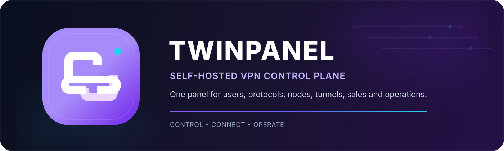

<p align="center">
  
</p>

<p align="center">
  <a href="README.md"><strong>English</strong></a> · <a href="README_FA.md">فارسی</a>
</p>

<p align="center">
  
  
  
  
  
</p>

# TwinPanel

**TwinPanel is a self-hosted VPN control plane for running users, subscriptions, protocols, nodes, tunnels, sales, payments, resellers, support, releases, and day-to-day operations from one place.**

It is designed for operators who want the core stack on infrastructure they control, with a unified web panel and a simple server-side management experience.

## Quick install

Run the official public installer on a clean Ubuntu 22.04 or 24.04 server:

```bash
curl -fsSL https://raw.githubusercontent.com/matin111/twinpanel/main/install.sh | sudo bash
```

The installer resolves the published Stable manifest and fetches the exact validated public Git commit declared by that release. No GitHub account, SSH key, Deploy Key, Personal Access Token, manual clone, or manual branch selection is required.

After installation, open the server management menu with:

```bash
twinpanel
```

Short alias:

```bash
tp
```

## What TwinPanel manages

| Area | Included |
|---|---|
| **Users & subscriptions** | Lifecycle, renewal, expiration, volume, delivery, status and quota-aware access |
| **VPN protocols** | Cisco/OpenConnect, OpenVPN, WireGuard, L2TP/IPsec and V2Ray/Xray |
| **Nodes** | Iran and Exit nodes, provisioning, health, repair and recovery |
| **Tunnels** | Iran → Exit paths, transport health, latency, watchdog and failover |
| **Modern Xray** | XHTTP/REALITY, gRPC/REALITY, WebSocket/TLS and HTTPUpgrade/TLS |
| **Store & payments** | Plans, checkout, discounts, receipts, crypto flows and payment operations |
| **Wallet & resellers** | Wallet balance/top-up, reseller customers, pricing and traffic credit |
| **Telegram & support** | Sales/management flows, notifications and support surfaces |
| **Operations** | Backup, diagnostics, releases, guarded update, rollback and licensing integration |
| **UI** | Admin, customer, reseller and storefront surfaces with Persian RTL / English LTR and Dark / Light modes |

## Architecture

```text
                         ┌──────────────────────────────┐
                         │           Internet           │
                         └──────────────┬───────────────┘
                                        │
                                  Nginx :80/:443
                                        │
                       ┌────────────────┴────────────────┐
                       │                                 │
                  Next.js Web                       FastAPI API
                    :3000                              :8095
                       │                                 │
                       └──────────────┬──────────────────┘
                                      │
                          ┌───────────┴───────────┐
                          │                       │
                     PostgreSQL                Redis
                          │                       │
                          └───────────┬───────────┘
                                      │
              ┌───────────────────────┼───────────────────────┐
              │                       │                       │
         Users / Sales          Nodes / Tunnels        VPN / Operations
```

TwinPanel keeps the customer VPN layer separate from the Iran → Exit transport layer so tunnel changes can be managed without unnecessarily rebuilding every customer account.

## Server management

The `twinpanel` / `tp` terminal menu is intentionally small and numeric-first. It gives fast access to:

- panel health and service state;
- safe API/Web/Nginx restart;
- VPN protocol management;
- release/update status;
- administrator tools;
- backups;
- logs and diagnostics;
- version and GitHub information.

## Installation requirements

- Ubuntu **22.04** or **24.04**
- Root access
- **2 GB RAM** recommended minimum
- **2 vCPU** recommended minimum
- At least **20 GB** free disk space
- Outbound Internet access
- Ports **80** and **443** for the public web endpoint

The installer prepares PostgreSQL, Redis, Python, Node.js, Nginx and systemd services as part of the deployment flow.

## Release model

TwinPanel uses a guarded release workflow rather than manual file replacement:

```text
Stable manifest
      ↓
Exact source SHA
      ↓
Install / build
      ↓
Atomic release switch
      ↓
Service restart
      ↓
Health verification
      ↓
Rollback on failed health
```

The active version is surfaced by the product and public customer updates are resolved from the validated release manifest.

## Documentation

- [English installation guide](docs/INSTALL_EN.md)
- [راهنمای نصب فارسی](docs/INSTALL_FA.md)
- [Persian repository overview](README_FA.md)
- [Trial / licensing specification](LICENSE_TRIAL_SPEC.md)
- [Product distribution notes](PRODUCT_DISTRIBUTION.md)

## Important paths

| Path | Purpose |
|---|---|
| `/opt/twinpanel/current` | Active application release |
| `/etc/twinpanel/backend.env` | Backend runtime configuration |
| `/etc/twinpanel/install.env` | Installation/release settings |
| `/var/lib/twinpanel-backups` | Backup storage |
| `/root/twinpanel-initial-admin.txt` | First-login credentials when initially created |
| `/usr/local/bin/twinpanel` | SSH management command |

## Security notes

- Keep `/etc/twinpanel/*.env` and installation secrets private.
- Change the initial administrator credentials after first login.
- Remove `/root/twinpanel-initial-admin.txt` after the first-login credentials are no longer needed.
- Use the guarded update path instead of editing production release files directly.
- Back up the system before infrastructure-level changes.

---

<p align="center">
  
</p>

<p align="center"><strong>TwinPanel</strong><br/>Control. Connect. Operate.</p>
