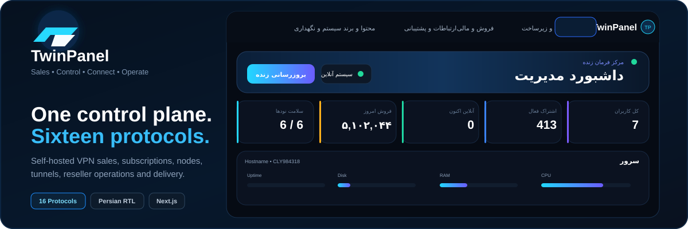

<p align="center">
  
</p>

<p align="center">
  <a href="README.md"><strong>English</strong></a> · <a href="README_FA.md">فارسی</a>
</p>

<p align="center">
  
  
  
  
  
  
</p>

# TwinPanel

**TwinPanel is a self-hosted VPN operations platform combining sales, 16 VPN/proxy protocol families, subscription and renewal management, reseller commerce, payments and wallets, multi-node infrastructure, tunnels, and branded client-app delivery.**

## ⚡ TwinConnect — Download & activate

<p align="center">The smart VPN companion for TwinPanel. One account, eligible servers and a simpler connection experience.</p>

<table>
  <tr>
    <td align="center" width="50%">
      <h3>🪟 Windows</h3>
      <p><strong>Available now</strong> · 64-bit installer · Beta 0.1.0</p>
      <a href="https://github.com/matin111/twinpanel/releases/tag/twinconnect-windows-v0.1.0-beta.1"></a>
    </td>
    <td align="center" width="50%">
      <h3>🤖 Android</h3>
      <p><strong>Available now</strong> · Android 1.0.0 · ARM64 APK</p>
      <a href="https://github.com/matin111/twinpanel/releases/tag/twinconnect-android-v1.0.0"></a>
      <p><a href="https://github.com/matin111/twinpanel/releases/download/twinconnect-android-v1.0.0/app-arm64-v8a-release.apk">Direct APK download (arm64-v8a)</a></p>
    </td>
  </tr>
  <tr>
    <td align="center">
      <h3>🍎 macOS</h3>
      <p>Desktop release planned for a future update</p>
      
    </td>
    <td align="center">
      <h3>📱 iPhone / iOS</h3>
      <p>iOS release planned for a future update</p>
      
    </td>
  </tr>
</table>

<p align="center">
  <a href="https://t.me/TwinPanelbot"></a>
</p>

> 🔐 **License required:** TwinConnect works only with a **TwinPanel license that includes app access**. A standard panel-only license does not activate the app. Select the app-enabled license in [@TwinPanelbot](https://t.me/TwinPanelbot).

Instead of running a separate billing panel, reseller system, Telegram sales bot, VPN node manager and tunnel monitor, TwinPanel brings the entire operational flow into one product:

```text
Customer / Reseller / Telegram Bot / Web Store
                    ↓
            Plan & Subscription
                    ↓
            Credential Delivery
                    ↓
       16 VPN / Proxy Protocols
                    ↓
        Iran / Relay / Exit Nodes
                    ↓
      Tunnel & Outbound Routing
                    ↓
          Internet / Services
```

TwinPanel is designed for real production operation: sales, customer delivery, quota accounting, multi-node infrastructure, tunnel health, failover, monitoring, support, backup, updates and day-to-day administration are managed from the same control plane.

## Recently added capabilities

- **Reserved subscription renewals:** paid renewals queue until the previous period expires or its quota is exhausted; eligible renewals activate on cutover without changing existing user credentials and connection profiles. The queue and activation history are visible in subscription management.
- **Wallets and payment verification:** customer and reseller balances, wallet-funded checkout/renewal, receipt review, transaction history, and configurable SMS/crypto verification flows.
- **Multi-brand TwinConnect integration:** central and reseller-specific app logo, colors, contacts, panel registration, and subscription-aware configuration delivery. Client engine availability still depends on the platform/build.
- **16 managed VPN/proxy protocol families:** including authenticated SOCKS5, with per-node adapter readiness and plan-specific protocol access.
- **Smarter infrastructure operations:** independent node provisioning, managed Iran/exit tunnels, outbound policies, health diagnostics, supported route-failover workflows and DNS-based emergency access options.
- **Richer sales and support operations:** plan categories, reseller traffic credit, Telegram broadcasts, account-delivery notifications, searchable admin activity history and subscription status indicators.
- **Safer administration:** data-focused backups with optional Telegram delivery, guarded updates/rollback, operational diagnostics and an integrated license center.

## Key operational highlights

TwinPanel unifies customer and reseller sales, Telegram delivery, subscription accounting, multi-node VPN operations and client distribution. Key workflows include:

- **Renewal continuity:** reserve a paid renewal until the current subscription expires or reaches its traffic limit, then activate it without changing the account's existing connection identity and profiles.
- **Financial traceability:** customer/reseller wallets, receipt verification, payment and renewal history, plus administrator adjustment history.
- **Operations and resilience:** node provisioning and repair, protocol readiness, tunnel and outbound route management, DNS emergency paths, health checks and monitoring.
- **Automation and support:** Telegram purchase/delivery/notifications, broadcast messaging, support workflows and data backup/recovery.
- **Reseller and license administration:** plan entitlements, traffic credit, reseller branding and centralized license management.

## TwinConnect — Smart VPN Client

**TwinConnect is the companion smart connection app for TwinPanel**, designed to present eligible servers and protocol profiles from a single subscription backend rather than requiring customers to manage each configuration manually.

- **Platform roadmap:** Windows, Android, macOS and iOS. Release availability and supported connection engines vary by operating system and build; do not assume feature parity.
- **Smart connection experience:** Quick Connect, explicit server/protocol selection, remembered selection, country grouping and connection state.
- **Connection visibility:** server latency, public IP, session duration, traffic rates and subscription status where supported.
- **Subscription-aware delivery:** only entitled plan categories and valid server profiles should appear; show quota, expiry, device allowance and reserved renewals where available.
- **Security and network controls:** Kill Switch, per-app Split Tunneling, DNS diagnostics and emergency connectivity paths, subject to platform support and verified implementation.
- **Multi-brand distribution:** reseller-specific logo, theme and support/renewal contacts controlled from TwinPanel.

**Important:** A protocol listed in TwinPanel is not necessarily a working native engine in every TwinConnect build. Connection, Kill Switch and Split Tunneling support must be validated per platform before a release is described as stable.

## Quick install

Run the official public installer on a clean Ubuntu 22.04 or 24.04 server:

```bash
curl -fsSL https://raw.githubusercontent.com/matin111/twinpanel/main/install.sh | sudo bash
```

The installer resolves the published Stable manifest and fetches the exact validated public Git commit declared by that release. No GitHub account, SSH key, Deploy Key, Personal Access Token, manual clone or manual branch selection is required.

After installation, open the server management menu with:

```bash
twinpanel
```

Short alias:

```bash
tp
```

# Product capabilities

## 1. Web Store and Sales

TwinPanel includes a customer-facing sales flow for turning plans into active VPN subscriptions.

- public storefront;
- configurable plans, plan categories, protocol entitlements and durations;
- traffic / volume limits;
- fixed-IP and regular service models;
- discounts and promotional flows;
- checkout and payment handling;
- payment receipt workflows;
- customer account creation, subscription delivery and renewal reservation;
- automatic access to connection information after successful activation;
- customer-facing tutorials and client-download guidance;
- Persian RTL and English LTR interfaces;
- Light and Dark themes.

## 2. Telegram Sales Bot

The Telegram sales system can operate as a complete sales and customer-delivery channel alongside the web store.

- browse plans;
- purchase subscriptions;
- payment and receipt flows;
- deliver connection information;
- customer notifications;
- subscription status, wallet-funded checkout and reserved renewal flows;
- broadcasts to bot users, including a purchase action in supported messages;
- configurable bot texts;
- operational notifications;
- integration with the same central subscription and quota model used by the web panel.

## 3. Reseller Platform

TwinPanel includes reseller workflows so operators can distribute services through independent sellers without creating a separate infrastructure stack.

- reseller accounts;
- reseller customers;
- reseller-specific pricing and plan/protocol eligibility;
- wallet and credit management;
- separately managed traffic credit / allocation and volume-package workflows;
- subscription creation and renewal;
- reseller Telegram bot support;
- per-reseller TwinConnect branding and contact links;
- centralized accounting and service ownership;
- admin control over reseller activity.

## 4. Customer Panel

Each customer can manage the services assigned to their account from a dedicated panel.

- active subscriptions;
- service status;
- expiration information;
- traffic / quota information, renewal reservations, activation status and subscription history;
- connection profiles;
- protocol-specific credentials;
- client application guidance;
- subscription and multi-link access where supported;
- wallet transactions, supported renewals, support and client-app downloads;
- online/offline indicators where a live protocol session can be observed.

# 16 VPN and proxy protocol families

TwinPanel manages **16 VPN and proxy protocol families** from one control surface. Availability depends on the node runtime, subscription plan and client integration.

## Classic protocols

| Protocol | Purpose |
|---|---|
| **Cisco / OpenConnect** | AnyConnect-compatible remote-access VPN |
| **OpenVPN** | Widely supported TLS-based VPN |
| **WireGuard** | Lightweight modern L3 VPN |
| **L2TP / IPsec** | Native compatibility with many operating systems |
| **V2Ray / Xray** | Flexible proxy/VPN profiles with modern transports |

## Modern protocols

| Protocol | Runtime / focus |
|---|---|
| **Hysteria2** | QUIC/UDP, high-loss and long-distance networks |
| **TUIC v5** | Low-latency QUIC transport |
| **AnyTLS** | TLS-oriented TCP transport for restricted networks |
| **NaiveProxy** | Browser-like HTTPS transport and camouflage |
| **ShadowTLS v3** | TLS camouflage transport |
| **Snell** | Lightweight encrypted proxy transport |
| **Mieru** | Modern encrypted proxy transport |
| **TrustTunnel** | Managed modern tunnel protocol integration |
| **AmneziaWG** | WireGuard-derived obfuscated VPN transport |
| **Sudoku** | Modern protocol integration managed by TwinPanel |

## Direct proxy

| Protocol | Purpose |
|---|---|
| **SOCKS5** | Authenticated TCP proxy for supported apps; SOCKS5 itself does not encrypt traffic |

The protocol control surface exposes runtime readiness instead of pretending that an unavailable adapter is healthy. Protocol state, configuration and node capability are tracked centrally.

## Xray / V2Ray transport profiles

TwinPanel also supports managed Xray/V2Ray profile variants such as:

- VLESS over TCP + TLS;
- VLESS over WebSocket + TLS;
- VLESS over XHTTP + REALITY;
- managed domains and TLS preparation;
- grouped customer configuration delivery;
- multi-server subscription presentation.

# Nodes and infrastructure

TwinPanel separates the **control plane** from the **VPN dataplane** and supports multiple infrastructure roles.

## Node roles

- Controller / Local Core;
- Iran nodes;
- Exit nodes;
- relay / transport roles where configured.

## Node management

- add and manage servers;
- protocol installation and repair;
- heartbeat and online/offline state;
- CPU, RAM and disk telemetry;
- active-user telemetry;
- protocol readiness;
- hostname and runtime information;
- provisioning over managed server connections;
- node configuration and publication independent from tunnel readiness, with per-protocol installation status;
- operational repair and recovery workflows.

# Tunnel control plane

TwinPanel includes a dedicated tunnel layer for carrying traffic between infrastructure nodes independently from customer credentials.

Typical topology:

```text
Client
  ↓
Iran Node
  ↓
Managed Tunnel / Transport
  ↓
Exit Node
  ↓
Internet
```

Tunnel capabilities include:

- Iran → Exit tunnel pairs;
- multi-transport architecture;
- TP27 transport integration;
- VXLAN-based transport paths;
- Spoof WG / WireGuard-derived transport paths;
- transport health monitoring;
- latency and availability status;
- tunnel heartbeat;
- route priority;
- automatic repair workflows;
- failover and recovery logic;
- transport scoring / health-aware selection where enabled;
- separation of customer VPN credentials from transport-layer tunnels.

This separation allows operators to repair or replace an Iran → Exit transport without rebuilding every customer account.

# Emergency DNS access

For highly restricted networks, TwinPanel has dedicated **NetMod DNS / DNSTT** and **DNS Emergency Iran Relay** management surfaces in addition to the normal VPN and tunnel control plane.

- managed DNSTT and SSH endpoint setup on eligible nodes, with DNS record guidance and `nm-dns://` import links for NetMod;
- install/repair, health checks, status and removal actions;
- DNS resolver and MTU diagnostics/performance testing;
- an Iran-side DNS ingress option that forwards to a configured Exit through an existing healthy tunnel.

These are optional recovery paths: their availability depends on DNS reachability, node configuration and client support. They do not guarantee connectivity during a network shutdown.

# Outbound and routing control

TwinPanel includes a dedicated outbound control surface for deciding how protocol traffic leaves the infrastructure.

- per-protocol outbound policy;
- default outbound selection;
- managed outbound registry;
- routing matrix;
- route readiness checks;
- configuration validation;
- guarded policy application;
- rollback-aware operations;
- outbound health and performance measurements;
- latency, throughput, jitter and stability measurements where available.

# Subscription lifecycle

Subscriptions are first-class objects rather than loose VPN credentials.

TwinPanel manages:

- pending / active / suspended / expired / canceled states;
- start-on-first-use workflows where configured;
- expiration and renewal;
- reserved renewals applied after the prior period expires or quota is consumed, without rotating existing credentials;
- subscription history and renewal audit trail;
- visible pending/blocked renewal state, retry/cancel controls where allowed, and automatic activation when eligible;
- traffic quotas;
- protocol credentials bound to the subscription;
- connection delivery;
- active-session state;
- usage accounting;
- revoke / restore workflows;
- customer, reseller and admin ownership paths.

# Accounting and quota core

The accounting layer is designed to keep traffic and subscription state centralized even when users connect through different protocols or nodes.

- append-only usage accounting model;
- active session tracking;
- quota-aware subscriptions;
- protocol/credential identity mapping and configurable concurrent-session limits (not a guaranteed physical-device count on every protocol);
- usage aggregation;
- reseller-aware accounting;
- traffic-limit enforcement hooks;
- online-user reporting;
- first-use activation support;
- central visibility across supported protocol runtimes.

# Admin dashboard and monitoring

The administration dashboard provides a live operational view of the platform.

- users and subscriptions;
- online sessions;
- node health;
- Controller CPU / RAM / disk / uptime;
- protocol readiness across all 16 families;
- pending renewals, wallet activity and payment-review status;
- searchable history of manual administrator actions;
- tunnel state;
- infrastructure status;
- revenue and sales indicators;
- operational notifications;
- update status.

# Support and notifications

TwinPanel includes built-in operational communication surfaces.

- support inbox;
- customer support workflows;
- admin notifications;
- Telegram broadcast messaging and payment/renewal notifications;
- read/unread state;
- tunnel and infrastructure status notifications;
- Telegram-related operational messaging.

# Backup, update and recovery

Production upgrades are handled through a guarded release flow rather than replacing files manually.

```text
Stable manifest
      ↓
Exact source SHA
      ↓
Verified production package
      ↓
Backup / migration safety checks
      ↓
Atomic release switch
      ↓
Service restart
      ↓
Health verification
      ↓
Automatic rollback on failed health
```

Operational tools include:

- data-only backup and restore for persistent panel records, including users, subscriptions, resellers, wallets and configuration records;
- manual/scheduled backup jobs and optional Telegram ZIP delivery;
- release status;
- guarded updates;
- atomic release activation;
- service health checks;
- rollback;
- repair actions;
- logs and diagnostics;
- terminal management through `twinpanel` / `tp`.

# License and app directory

The integrated License Center shows the panel's license/trial status, expiry, remaining time and current version. Administrators can activate a license and register or update the HTTPS panel address used by the centrally licensed TwinConnect app directory.

# Admin surfaces

TwinPanel ships multiple product surfaces instead of one monolithic admin page:

| Surface | Purpose |
|---|---|
| **Admin Dashboard** | Platform-wide status and operational overview |
| **Users** | Customer accounts and access state |
| **Subscriptions** | Lifecycle, quota, reserved renewal queue, history and delivery |
| **Plans / Store** | Commercial products and public sales |
| **Resellers** | Seller accounts, plan access, pricing, wallet and volume credit |
| **Nodes** | Infrastructure servers and protocol runtime |
| **Protocols** | 16-family VPN/proxy control surface and runtime readiness |
| **Tunnels** | Iran/Exit transport management |
| **Outbounds** | Egress and per-protocol routing policy |
| **Payments** | Payment, wallet, receipt review, SMS/crypto verification and transactions |
| **Client App / Branding** | TwinConnect logo, colors, contacts, panel directory and reseller identity |
| **DNS Emergency** | NetMod DNS/DNSTT and Iran Relay installation, health and diagnostics |
| **License Center** | License status, activation, expiry and app-panel registration |
| **Support** | Support and communication workflows |
| **System & Maintenance** | Settings, searchable admin activity, backup, security and Update Center |

# Architecture

```text
                                   ┌─────────────────────┐
                                   │     Customers       │
                                   └──────────┬──────────┘
                                              │
              ┌───────────────────────────────┼───────────────────────────────┐
              │                               │                               │
        Web Store / Panel               Telegram Bot                    Reseller Panel
              │                               │                               │
              └───────────────────────────────┼───────────────────────────────┘
                                              │
                                      TwinPanel Control Plane
                                              │
                    ┌─────────────────────────┼─────────────────────────┐
                    │                         │                         │
               Next.js Web               FastAPI API              Background Workers
                    │                         │                         │
                    └───────────────┬─────────┴─────────┬───────────────┘
                                    │                   │
                              PostgreSQL              Redis
                                    │                   │
                 ┌──────────────────┼───────────────────┼──────────────────┐
                 │                  │                   │                  │
             Accounts          Accounting          Nodes             Tunnels
                 │                                      │                  │
                 │                                 Iran / Exit ───── Transport
                 │                                      │                  │
                 └────────────── 16 VPN/Proxy Protocols ──────┴────── Outbound ──┘
                                                                │
                                                             Internet
```

# Server management

The `twinpanel` / `tp` terminal menu provides fast access to:

- panel and service health;
- safe API/Web/Nginx restart;
- VPN protocol management;
- update and release status;
- administrator tools;
- backups;
- logs and diagnostics;
- version and GitHub information.

# Installation requirements

- Ubuntu **22.04** or **24.04**;
- root access;
- **2 GB RAM** recommended minimum;
- **2 vCPU** recommended minimum;
- at least **20 GB** free disk space;
- outbound Internet access;
- ports **80** and **443** for the public web endpoint.

The installer prepares PostgreSQL, Redis, Python, Node.js, Nginx and systemd services as part of the deployment flow.

# Technology stack

- **Backend:** Python 3.12 + FastAPI
- **Frontend:** Next.js
- **Database:** PostgreSQL
- **Cache / runtime state:** Redis
- **Reverse proxy:** Nginx
- **Service management:** systemd
- **Deployment:** immutable release directories + atomic activation
- **UI:** Persian RTL + English LTR, Light / Dark modes

# Documentation

- [English installation guide](docs/INSTALL_EN.md)
- [راهنمای نصب فارسی](docs/INSTALL_FA.md)
- [Persian repository overview](README_FA.md)
- [Trial / licensing specification](LICENSE_TRIAL_SPEC.md)
- [Product distribution notes](PRODUCT_DISTRIBUTION.md)

# Important paths

| Path | Purpose |
|---|---|
| `/opt/twinpanel/current` | Active application release |
| `/etc/twinpanel/backend.env` | Backend runtime configuration |
| `/etc/twinpanel/install.env` | Installation/release settings |
| `/var/lib/twinpanel-backups` | Backup storage |
| `/root/twinpanel-initial-admin.txt` | First-login credentials when initially created |
| `/usr/local/bin/twinpanel` | SSH management command |

# Security notes

- Keep `/etc/twinpanel/*.env` and installation secrets private.
- Change the initial administrator credentials after first login.
- Remove `/root/twinpanel-initial-admin.txt` after the first-login credentials are no longer needed.
- Use the guarded update path instead of editing production release files directly.
- Back up the system before infrastructure-level changes.
- Never commit production credentials, API tokens, private keys or server secrets to the repository.

---

<p align="center">
  
</p>

<p align="center"><strong>TwinPanel</strong><br/>Sales. Control. Connect. Operate.</p>
